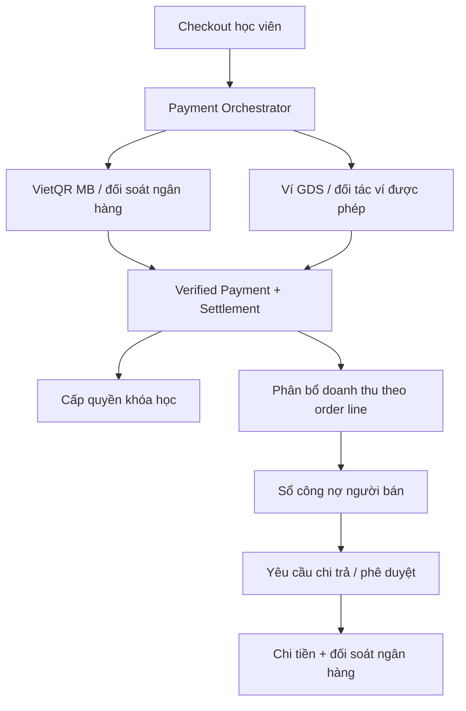

# EduAI — Kiến trúc thanh toán, Ví GDS và chia doanh thu

**Bản thiết kế và roadmap đề xuất — 22/10/2026**  
**Phạm vi:** EduAI Back-End, Front-End-Web và EduAI-Workspace  
**Trạng thái:** Thiết kế; chưa thay đổi code, dữ liệu tài chính hoặc production.

## 1. Quyết định kiến trúc

EduAI phát triển **hai nghiệp vụ khác nhau**, dùng chung cơ chế xác nhận giao dịch và đối soát:

1. **Ví GDS cho học viên:** học viên nạp tiền, xem số dư, dùng số dư mua khóa học và nhận hoàn tiền theo chính sách được phê duyệt. **Không cho học viên rút số dư tùy ý về ngân hàng**; hoàn tiền là quy trình riêng, không phải chức năng rút tiền, và phải bảo đảm các trường hợp hoàn tiền bắt buộc theo pháp luật. Trong môi trường thực, chức năng lưu giữ giá trị tiền tệ/nạp–chi phải triển khai thông qua một **đơn vị cung ứng dịch vụ đủ điều kiện/được cấp phép** và được tư vấn pháp lý xác nhận. EduAI chỉ giữ dữ liệu giao dịch và sổ đối chiếu (mirror), **không tự đóng vai đơn vị phát hành ví điện tử** khi chưa đủ điều kiện.
2. **Ví doanh thu cho người bán:** đây là **sổ theo dõi khoản phải trả** (seller earnings/payable ledger), không phải ví điện tử lưu giữ tiền. Nó ghi nhận doanh thu phát sinh từ đơn đã xác minh, phần được phân bổ cho người bán, các khoản giữ lại, hoàn tiền, công nợ và chi trả thực tế.

**Phương thức thu tiền tạm thời:** VietQR vào **MB Bank — 1122883979**. Tên người thụ hưởng “Giáo dục số” là thông tin người dùng cung cấp; cần kiểm tra tên chủ tài khoản thực tế và thẩm quyền thu tiền của pháp nhân trước khi mở chính thức. Không dùng lại QR PayOS dưới một nhãn khác.

**Nguyên tắc:** một khoản tiền được ngân hàng/đối tác xác thực chỉ được ghi nhận một lần; một lần xác nhận đơn chỉ tạo một tập phân bổ doanh thu và một lần cấp quyền học tập. Không bao giờ coi ảnh chuyển khoản, redirect frontend, nút “Đã thanh toán” hay đồng hồ QR là bằng chứng tiền đã về.

## 2. Hiện trạng hệ thống — điểm tích hợp

Qua kiểm tra `main` ngày 22/10/2026:

- Backend `src/modules/payments/payment-provider.ts` chỉ định nghĩa provider `payos | vnpay`; registry và cấu hình mặc định nằm ở `payment-provider.registry.ts`, `payments.module.ts`.
- `payment-request.service.ts` quản lý payment attempt, idempotency, thời hạn và QR/checkout artifact.
- Prisma có `CommerceOrder`, `CommerceOrderLine.sellerId`, `CommercePaymentAttempt`, `CommerceSettlement`, `CommerceReconciliationCase`, `CommerceRefund`. EduAI **đã có ví điểm TMI** với sổ điểm bất biến, nhưng **TMI không phải tiền** và không được chuyển đổi trực tiếp thành Ví GDS. Chưa có ví tiền học viên hoặc sổ công nợ/chi trả người bán chuyên dụng.
- Frontend `PaymentCheckout.tsx` hiển thị QR PayOS hoặc VNPay; `payment.service.ts` chỉ chấp nhận `payos | vnpay`.
- ADR-004 quy định **xác nhận tài chính** và **cấp quyền khóa học** là hai giao dịch độc lập, idempotent. Phải giữ ranh giới này khi bổ sung ví và sổ doanh thu.
- Workspace còn release gate `SPR25-007` chờ thao tác thủ công. Mọi kích hoạt production phải phù hợp cổng kiểm soát hiện hành, không tự ý ghi đè trạng thái cũ.

Các kết luận này là kết quả rà soát kiến trúc sơ bộ, không thay thế full audit trước khi sửa code.

## 3. Kiến trúc đích



### Các ranh giới cần giữ

| Thành phần | Trách nhiệm | Nguồn xác thực |
|---|---|---|
| `Payment Core` | Order/attempt/settlement, trạng thái chuẩn, khôi phục và đối soát | Provider/bank verified event |
| `BankTransferAdapter` | VietQR từng đơn, mã chuyển khoản, bằng chứng sao kê/API | Sao kê MB đã xác minh hoặc API được ngân hàng cấp quyền |
| `BuyerWalletAdapter` | Nạp tiền, số dư, giữ chỗ, trừ tiền, hoàn trả, callback | Đối tác ví được cấp phép, không phải frontend |
| `RevenueAllocation` | Chốt tỷ lệ chia và số tiền trên từng dòng hàng | Settlement đã matched + policy snapshot |
| `SellerEarningsLedger` | Pending/available/held/paid, refund adjustment | Sổ cái bút toán bất biến |
| `Payout` | Yêu cầu rút, phê duyệt, chuyển tiền, đối soát | Chứng từ ngân hàng/API chi hộ đã xác minh |
| `Admin Finance` | Cấu hình chính sách, duyệt đối soát và chi trả, báo cáo | Phân quyền + audit + quy tắc hai người |

Không dùng một biến `walletBalance` cập nhật trực tiếp để quyết định tiền được chi tiêu/rút. Số dư hiển thị là kết quả của bút toán và trạng thái đối soát; backend khóa tài nguyên và xử lý cạnh tranh giao dịch trong transaction.

## 4. Luồng thanh toán

### A. Học viên trả tiền bằng QR MB

1. Server tạo một payment attempt chứa `orderId`, số tiền VND, nội dung chuyển khoản duy nhất, hạn đối soát của **đơn hàng**, tài khoản ngân hàng nhận tiền đã được xác minh.
2. Hiển thị mã VietQR sinh riêng theo đơn, có số tiền và mã tham chiếu; có nút sao chép STK/nội dung, tải QR và quay lại. Không dùng ảnh chụp QR làm nguồn cấu hình.
3. Khi chưa có kết nối MB, giao dịch nằm `PENDING_BANK_VERIFICATION`; Admin đối chiếu trực tiếp giao dịch đến từ sao kê chính thống rồi xác nhận có kiểm soát. Ảnh biên lai học viên chỉ dùng hỗ trợ tra cứu, không cho phép tự đánh dấu `PAID`.
4. Chỉ khi **tài khoản nhận + số tiền + mã đơn + giao dịch ngân hàng + tính duy nhất** hợp lệ mới tạo một `CommerceSettlement` matched và đi vào quy trình fulfillment hiện hành.
5. QR chuyển khoản ngân hàng không thể bị vô hiệu hóa ở phía app sau khi đã phát hành. Khi đơn hết hạn/hủy nhưng tiền vẫn đến, mở case `LATE_TRANSFER_REVIEW` để xử lý theo chính sách; không tự cấp khóa học cho đơn đã đóng.
6. Về sau, chỉ thêm MB Bank API hoặc Virtual Account khi doanh nghiệp được cấp quyền truy cập và đã chứng minh được đối soát/tính duy nhất; không scraping SMS, email ngân hàng hoặc tài khoản cá nhân.

### B. Học viên dùng Ví GDS

1. Học viên liên kết/được nhận diện bởi đối tác phát hành ví (bao gồm KYC theo yêu cầu của đối tác và pháp luật).
2. Nạp tiền: `INITIATED → PENDING_PARTNER → VERIFIED → CREDITED` hoặc `FAILED/REVIEW` sau sự kiện đối tác xác thực. Không cộng số dư từ frontend return.
3. Thanh toán khóa học: kiểm tra `availableBalance`, tạo reservation idempotent theo order, gọi lệnh đối tác để giữ/trừ tiền và chốt thành công theo hợp đồng API. Chỉ sau xác minh `CAPTURED` mới ghi canonical settlement. Nếu callback mất/kết quả bất định, khóa attempt và đối soát trước khi cho thử lại.
4. Thanh toán bị hủy/thất bại: giải phóng reservation đúng một lần. Hoàn tiền: chỉ thực hiện theo chính sách đã phê duyệt và quyền lợi bắt buộc áp dụng, qua quy trình/API đối tác phù hợp; chỉ ghi hoàn thành khi nguồn xác thực xác nhận. Không có API/UI cho học viên tự rút số dư tùy ý. Quy tắc điều kiện, thời hạn, nguồn nhận hoàn và ngoại lệ phải được chốt trước vận hành thật.
5. Giai đoạn đầu chỉ hỗ trợ **một nguồn thanh toán trên mỗi đơn**: hoặc đủ số dư Ví GDS hoặc toàn bộ bằng QR MB. Không cho thanh toán kết hợp hai nguồn trước khi thiết kế được atomicity, hoàn tiền từng phần và đối soát hai nguồn.
6. Mọi khoản tiền thật/số dư khả dụng của học viên do đối tác được phép quản lý; EduAI lưu bản ghi đối chiếu, không cho Admin tự tạo số dư có giá trị tiền.

### C. Bán khóa học — chia doanh thu — chi người bán

1. Đơn hàng đã matched và được xác nhận tạo một sự kiện phân bổ duy nhất trên từng `CommerceOrderLine`.
2. Mỗi dòng khóa học lấy `sellerId` từ snapshot hiện hữu và phiên bản chính sách tỷ lệ có hiệu lực tại thời điểm chốt đơn.
3. Bút toán phần người bán ở `PENDING` trong thời gian giữ lại; chỉ chuyển sang `AVAILABLE` khi hết điều kiện giữ lại và không có tranh chấp/hoàn tiền cần xử lý.
4. Người bán yêu cầu chi tiền **không vượt `AVAILABLE`**; hệ thống chuyển khoản đó vào trạng thái đã giữ (`PAYOUT_RESERVED`).
5. Tối thiểu hai vai trò tách biệt: người đề nghị/duyệt và người xác nhận đã chuyển tiền; mã xác thực mạnh cho hành động nhạy cảm. Khi ngân hàng xác nhận, ghi một `PAID` journal + external bank reference. Có thể tích hợp chi hộ sau, không làm ngay.
6. Nếu hoàn tiền trước chi trả, đảo/điều chỉnh khoản payable; sau chi trả, tạo công nợ khấu trừ hoặc quy trình thu hồi theo hợp đồng, không xóa bút toán gốc.

## 5. Chính sách chia doanh thu

Admin có quyền đặt tỷ lệ **mặc định toàn hệ thống**, ghi đè theo **người bán**, sau đó **khóa học**. Độ ưu tiên: khóa học > người bán > mặc định. Chính sách có hiệu lực từ một thời điểm xác định, có `policyVersion`, người tạo/duyệt và lý do thay đổi; đơn đã đặt không bị tính lại âm thầm khi Admin đổi tỷ lệ.

Ví dụ (chưa tính thuế, phí ngân hàng, hoa hồng Affiliate): khóa học sau giảm giá còn **500.000đ**, tỷ lệ `EduAI 20% / Người bán 80%` → **EduAI 100.000đ, người bán 400.000đ**. Khi làm tròn đơn vị VND, phần còn lại phải được quy định theo một quy tắc bất biến để tổng đúng bằng giá trị phân bổ.

**Cần chốt trong ADR trước khi ghi tiền:**

- Cơ sở chia là doanh thu **sau giảm giá**, có/không gồm VAT, và bên nào gánh phí giao dịch.
- Hoa hồng Affiliate (nếu có) khấu trừ trước hay sau chia và tính trên phần của ai.
- Khóa học/tư cách thành viên bán bởi chính EduAI có tỷ lệ 100% hệ thống hay chính sách khác.
- Thời gian giữ lại tiền người bán, hạn mức rút, lịch chi tiền, xử lý khiếu nại và hoàn tiền.
- Pháp nhân bán hàng trên hóa đơn: EduAI là bên bán (merchant of record) hay là trung gian thu hộ cho người bán; điều này ảnh hưởng hợp đồng, hóa đơn, thuế, quyền nhận và chi tiền.

## 6. Mô hình dữ liệu đề xuất

| Nhóm | Bảng/khái niệm đề xuất | Quy tắc chính |
|---|---|---|
| Chính sách | `RevenueSharePolicy`, `RevenueSharePolicyVersion` | Immutable version, phạm vi global/seller/course, effectiveAt |
| Phân bổ | `RevenueAllocation` | Unique `(settlementId, orderLineId, allocationKind)`, snapshot tỷ lệ, điều chỉnh/refund |
| Sổ cái | `FinanceJournal`, `FinancePosting` | Append-only, debit = credit, idempotency source ID, amount VND integer |
| Ví học viên | `BuyerWalletLink`, `BuyerWalletTransaction`, `BuyerWalletReservation`, `WalletProviderEvent` | Mirror số dư provider, bảo toàn thứ tự/callback retry, không tự phát hành tiền |
| Ví người bán | `SellerEarningsAccount`, `SellerEarningsMovement` | Pending/available/held/paid, số dư suy ra từ journal |
| Chi trả | `SellerPayoutRequest`, `SellerPayoutApproval`, `SellerPayoutTransfer` | Dual approval, reservation, ngân hàng reference duy nhất |
| Đối soát | `BankReceiptEvidence`, `FinanceReconciliationCase` | Chứng từ, duplicate, late, mismatch, refund, payout uncertainty |
| Kiểm toán | `FinanceAuditEvent` | Ai, khi nào, hành động, phiên bản thay đổi; redact dữ liệu nhạy cảm |

Tên bảng là **đề xuất**, cần rà lại schema thực tế và đặt tên theo conventions hiện hành. Tách bảng sổ cái với bảng hiển thị số dư; số dư cache phải tái dựng được từ journal.

### Bất biến tài chính bắt buộc

- Mỗi provider/bank transaction ID được áp dụng tối đa một lần; webhook có thể đến nhiều lần, khác thứ tự hoặc sau timeout.
- Mọi journal cân bằng, không được xóa/sửa bút toán đã posted; sửa sai bằng reversal/compensating entry có nguồn gốc truy vết.
- Một payment attempt không được vừa `PAID` và `CANCELLED` mà không có trạng thái review/reversal giải thích.
- Chặn double spend Ví GDS dưới cạnh tranh; không cho seller available/withdrawable âm (trừ công nợ điều chỉnh được định nghĩa riêng).
- Payment confirmation, fulfillment và revenue allocation chạy độc lập bằng outbox/idempotent consumer; lỗi ở downstream không đảo một khoản thu đã xác thực.
- DB migration phải tương thích với dữ liệu PayOS/VNPay lịch sử; không backfill doanh thu tài chính bằng giả định.
- Full audit, least privilege, RBAC, approval separation, rate limiting và 2FA/MFA cho hành động tiền.

## 7. Giao diện sản phẩm

**Checkout:** phương thức `1. Quét QR ngân hàng (MB Bank)` và `2. Ví GDS`; hiện trạng thái khả dụng từ server, số dư Ví GDS (khi có đối tác), mã QR từng đơn, đồng hồ hạn đơn hàng, mã chuyển khoản, trạng thái xác minh và hướng dẫn sai/lệch/chậm thanh toán. Phân biệt rõ “Đã gửi bằng chứng” với “Đã thanh toán”. Không hứa QR ngân hàng tự hết hiệu lực.

**Học viên:** trang Ví GDS gồm số dư khả dụng, tiền đang xử lý, nạp tiền, mua khóa học bằng số dư, yêu cầu hoàn tiền theo chính sách, lịch sử, khiếu nại; không có thao tác rút số dư tùy ý.

**Người bán:** Dashboard doanh thu gồm tổng bán, chờ đối soát, chờ đủ điều kiện, khả dụng, đã yêu cầu chi, đã chi, điều chỉnh hoàn tiền; lịch sử theo từng khóa học/đơn và yêu cầu chi trả.

**Admin:** Cấu hình tỷ lệ có phiên bản, quy tắc thời gian giữ lại, đối soát MB/đối tác ví, phiếu ngoại lệ, duyệt chi tiền, báo cáo công nợ, nhật ký hành động; hai người duyệt/xác nhận cho chuyển tiền. Cần bộ lọc, phân trang, file xuất và UX responsive từ 320px.

## 8. Kiểm soát pháp lý và quyền hoạt động

Đây là cổng kiểm soát **bắt buộc trước production**, không phải khẳng định kết luận pháp lý cho riêng EduAI:

1. **Ví học viên:** rà soát Nghị định **52/2024/NĐ-CP**, Thông tư **40/2024/TT-NHNN** cùng sửa đổi bởi **41/2025/TT-NHNN** và **22/2026/TT-NHNN**. Mô hình giữ giá trị tiền, nạp/rút và thanh toán bằng số dư cần ý kiến tư vấn pháp lý và hợp đồng đối tác được phép; nếu chưa có thì chỉ phát triển sandbox/feature flag OFF.
2. **Đối tác:** xác minh giấy phép, phạm vi ví điện tử, quy trình KYC/AML, bảo đảm tiền của khách hàng, API xác nhận số dư/giao dịch, refund, dispute, SLA, cơ chế đối soát và xử lý khi đối tác ngừng hoạt động. Không nhầm API thanh toán PayOS/VNPay với quyền tự phát hành ví.
3. **Thu và chia cho người bán:** tư vấn hợp đồng marketplace/ủy quyền thu hộ, merchant of record, tài khoản nhận tiền, thuế và hóa đơn. Tiền thu hộ và phần phải trả người bán phải minh bạch, được đối soát với số dư ngân hàng thực.
4. **Dữ liệu:** không lưu thông tin xác thực ngân hàng, bí mật webhook, thông tin KYC thô hoặc dữ liệu thẻ trong log; mã hóa thông tin cần thiết và kiểm soát quyền truy cập.

**Tài liệu chính thức tham chiếu:**

- [Nghị định 52/2024/NĐ-CP](https://vbpl.vn/van-ban/chi-tiet/nghi-dinh-so-52-2024-nd-cp-quy-dinh-ve-thanh-toan-khong-dung-tien-mat--167087)
- [Thông tư 41/2025/TT-NHNN](https://chinhphu.vn/?docid=215823&pageid=27160)
- [Thông tư 22/2026/TT-NHNN, hiệu lực 19/05/2026](https://chinhphu.vn/?docid=218213&pageid=27160)
- [NAPAS giới thiệu VietQR](https://napas.com.vn/napas-va-cac-ngan-hang-chinh-thuc-ra-mat-thuong-hieu-vietqr-va-dich-vu-chuyen-tien-nhanh-napas247-bang-ma-qr-182755.htm)
- [MBBank tài liệu callback thanh toán cho đối tác đã đăng ký](https://integration-mini-app.mbbank.com.vn/docs/home/apispec/payment/transaction-callback/)

## 9. Roadmap PAYW theo phase nhỏ, trọn vòng Codex

Mỗi phase con thực hiện đầy đủ **đọc Workspace → thiết kế → implement → test → review → commit/PR/CI → evidence**, không tách implementation/review/runtime thành nhiều lần hỏi người dùng. Giữ release gate và quy tắc tự động hóa PR của EduAI hiện hành; không thực hiện hành động tài chính production khi chưa đạt điều kiện.

| Phase | Phạm vi | Sản phẩm bàn giao và điều kiện hoàn tất |
|---|---|---|
| **PAYW-00 — Governance & ADR** | Audit Payment Core, merchant-of-record, điều khoản seller, đối tác ví, chính sách chia, trạng thái release gate | ADR kiến trúc, contract API, bảng quyết định pháp lý/tài chính, test matrix; không bật luồng tiền mới |
| **PAYW-01 — VietQR MB manual** | Provider `bank_transfer` độc lập; QR từng đơn; UI mới; pending/expiry/late; Admin đối soát từ ngân hàng | Tests mismatch/duplicate/late/expiry; UAT chuyển khoản dùng bằng chứng phù hợp; chuyển default chỉ sau xác minh ngân hàng và nghiệm thu |
| **PAYW-02 — Revenue allocation** | Policy theo global/seller/course, version/snapshot, split per order line, posting immutable, refund adjustment | Tất cả đơn paid phân bổ đúng một lần, replay idempotent; Admin cấu hình; seller có báo cáo read-only |
| **PAYW-03 — Seller earnings & payout** | Pending→available, hold, payout request, dual approval, xác nhận chi thủ công, đối soát | Seller/Admin UI, quyền hạn, tests double payout/concurrent withdrawal/refund after payout; chưa auto-transfer |
| **PAYW-04 — Buyer wallet sandbox** | Adapter đối tác ví, mirror/hold/debit/refund, UI học viên, fault injection | Sandbox/provider mock, zero real funds; pass tests double spend, out-of-order callbacks, timeout, refund, crash recovery; feature OFF production |
| **PAYW-05 — Licensed partner + live UAT** | Hợp đồng và tích hợp đối tác được phép, KYC/AML, đối soát, nạp/sử dụng/hoàn tiền, DR/incident runbook | Bằng chứng pháp lý + security review + sandbox UAT + production canary; chỉ khi phê duyệt mới bật Ví GDS |
| **PAYW-06 — Optional automation** | MB API/Virtual Account, chi hộ tự động, báo cáo quyết toán nâng cao | Chỉ triển khai khi có quyền ngân hàng/đối tác, chính sách dual-control và UAT; không phải phụ thuộc của PAYW-01–PAYW-05 |

### Thứ tự ưu tiên đề xuất

`PAYW-00 → PAYW-01 → PAYW-02 → PAYW-03`, song song chuẩn bị hồ sơ đối tác ví ở cấp nghiệp vụ; sau đó `PAYW-04 → PAYW-05`. `PAYW-06` là tùy chọn sau. Không chờ cấp phép ví học viên mới triển khai sổ công nợ người bán an toàn. Mã `PAYW` tránh va chạm với `SPRINT:26` Analytics trong AI-DOS hiện hữu.

### Các cổng nghiệm thu chung

- Full backend tests, typecheck, build; frontend unit/E2E, desktop/mobile; database migration kiểm tra idempotency và rollback an toàn.
- Kiểm thử số tiền sai, mã đơn sai, callback giả mạo, callback trùng/đảo thứ tự, đơn hết hạn nhưng tiền đến, partial/full refund, crash giữa settlement–fulfillment–ledger.
- Học viên không được mua bằng ví thiếu số dư; người bán không được rút hai lần khi gửi request đồng thời.
- Hệ thống giải thích được từng đồng: **tiền nhận qua ngân hàng/đối tác ↔ settlement ↔ phân bổ ↔ công nợ seller ↔ tiền đã chi**.
- Mọi rollout có flag/tắt nhanh, migration tiến/lùi an toàn, monitor/reconciliation dashboard; giữ lịch sử PayOS/VNPay; không ghi đè task/evidence hiện tại.

## 10. Quyết định bắt buộc trước từng cổng

| Quyết định | Trước phase | Chủ trì |
|---|---|---|
| Xác minh chủ tài khoản MB 1122883979, pháp nhân có quyền nhận tiền, quy trình đối soát ngân hàng | PAYW-01 | Chủ tài khoản + tài chính |
| EduAI là bên bán hay trung gian thu hộ; hợp đồng seller và hóa đơn/thuế | PAYW-02 | Lãnh đạo + kế toán + pháp lý |
| Tỷ lệ mặc định, phí, VAT, Affiliate, thời gian giữ lại, ngưỡng/lịch chi | PAYW-02/03 | Admin nghiệp vụ + tài chính |
| Nhà cung cấp dịch vụ phù hợp, hợp đồng, KYC/AML khi áp dụng, cơ chế bảo đảm tiền, quy trình hoàn tiền theo chính sách (không rút tùy ý) | PAYW-05 | Pháp lý + nhà cung cấp |
| Quyền kích hoạt production, CI/UAT và quy trình xử lý sự cố | Mọi phase tiền | Release owner |

## 11. Prompt khởi động cho Codex

```text
PROJECT: EDUAI — PAYMENT, BUYER WALLET, SELLER EARNINGS

Read EduAI-Workspace canonical state, all relevant AGENTS.md, ADR-004/005,
backend and frontend payment/commerce code, migrations and existing CI/UAT.

The approved target architecture has two distinct wallet concerns:
(1) Buyer Ví GDS is provider-issued/regulated money movement; EduAI mirrors
partner-authoritative verified transactions, never self-issues stored money
in production without the legal/partner gate.
(2) Seller wallet is an internal earnings/payables ledger with settlement,
holds, refunds, manual dual-approved payouts and reconciliation.

Temporary payment account: MB Bank 1122883979. Verify actual beneficiary
and contractual receiving rights before live use. Create a distinct
bank_transfer provider and per-order VietQR. Never replace the PayOS QR
image while retaining PayOS webhook/settlement semantics.

Read EDUAI_WALLET_PAYMENT_ARCHITECTURE_ROADMAP_2026.md provided with the task
as the architecture proposal. Reconcile all assumptions against current code
and Workspace; write/update ADR and phased tasks PAYW-00–PAYW-06 without corrupting
existing SPRINT:25 release gates, SPRINT:26 Analytics, or TMI points ledger. Phase by phase: read → implement → tests →
review → PR/CI → evidence; remediate ordinary failures. Production financial
activation stays gated by verified bank evidence, legal/partner approval,
release authorization and real UAT. No fabricated transactions, no manual
force-PAID, no automatic payout, no historical settlement mutation.

Start with PAYW-00 complete governance/audit deliverables, then PAYW-01 only if
its bank/business prerequisites are satisfied. Report blockers clearly.
```

---

**Khuyến nghị cuối:** triển khai nhận VietQR MB và sổ chia doanh thu trước, nhưng không để tài khoản MB chung trở thành “ví lưu giữ tiền học viên” không có cơ chế pháp lý và đối soát. Cùng một giao diện “Ví GDS” có thể phục vụ người học, song khả năng lưu giữ và chi tiêu số dư thật phải đến từ đối tác hợp lệ.
